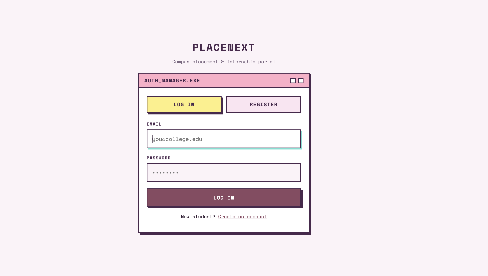
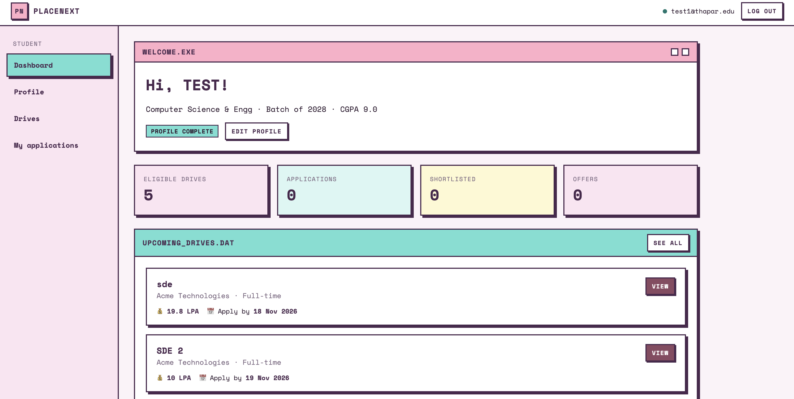
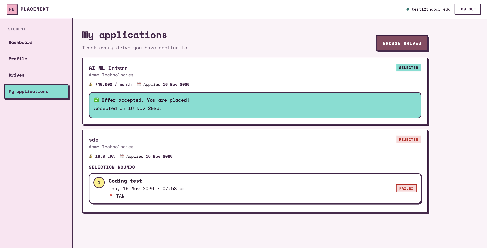
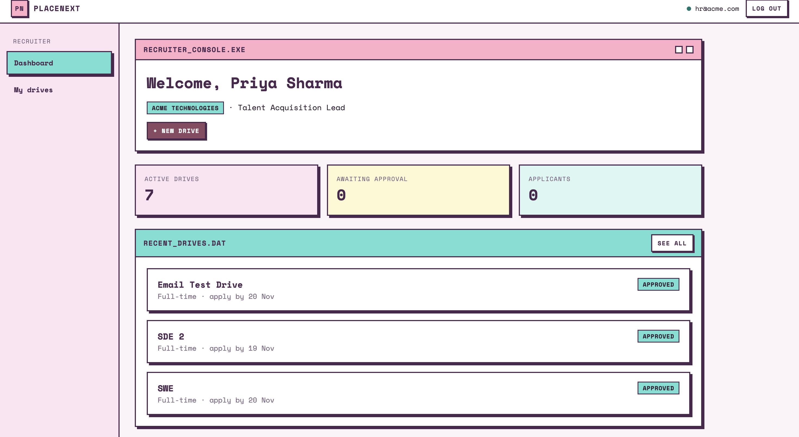
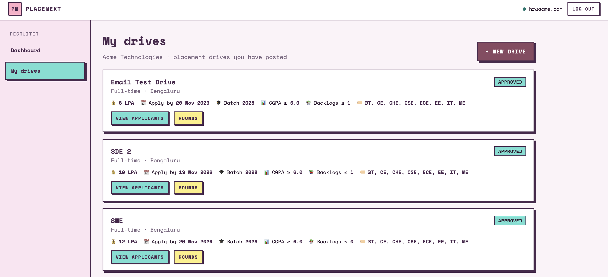
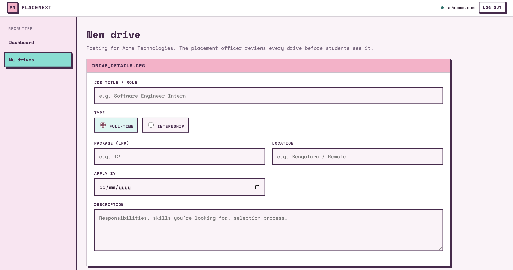
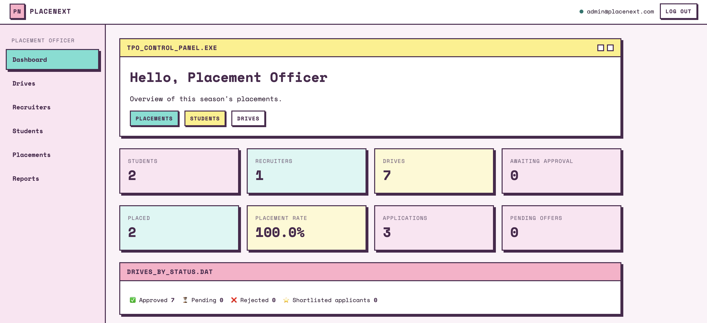
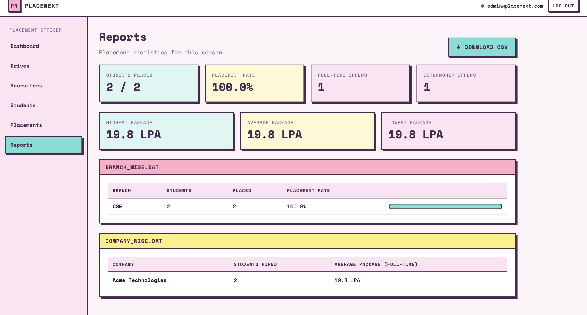
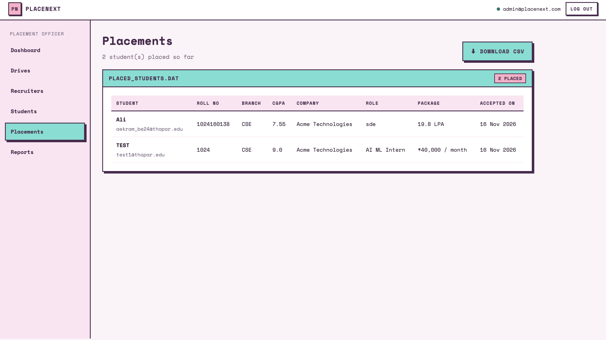

# PlaceNext – Campus Placement & Internship Management Portal

PlaceNext is a web portal that runs a college's placement season end to end:
recruiters post drives, students apply to the ones they're eligible for, recruiters
run selection rounds and make offers, and the placement office tracks everything
with live stats, reports and CSV exports.

Built by **Ali Ekram** and **Ishan** as a Spring Boot project.

---

## Features

### 🎓 Student
- Register, build a profile (branch, batch, CGPA, backlogs, phone) and upload a resume
- See every open drive with an **eligibility check** that explains exactly why you can or can't apply
- Apply to or withdraw from drives
- Track each application: status, selection rounds, and Passed / Failed / Pending per round
- **Accept or decline offers**. Accepting places you, auto-declines other pending offers and withdraws open applications

### 🏢 Recruiter
- Post placement drives (full-time with CTC, or internship with stipend) with eligibility rules: min CGPA, max backlogs, batch, allowed branches
- View and filter applicants, shortlist / reject / select, and download applicants as CSV
- Schedule selection rounds and record results per student (a failed round auto-rejects)

### 🛡️ Placement Officer (Admin)
- Approve or reject drives before students can see them
- Dashboard with students, recruiters, drives, placed count, placement rate and pending offers
- Students list with search and branch / placement filters
- Placements list of every accepted offer
- Reports: branch-wise and company-wise placement, highest / average / lowest package
- One-click **CSV exports** for students, placements and reports

### ✉️ Email notifications
Students are emailed when they're shortlisted, rejected, selected, or pass/fail a round.
Recruiters are emailed when a drive is approved/rejected and when an offer is accepted/declined.
Emails are sent in the background; by default they're printed to the console so the app works without any mail setup.

---

## Screenshots

| Login | Student dashboard |
|---|---|
|  |  |

| My applications (rounds & offer) | Recruiter dashboard |
|---|---|
|  |  |

| Recruiter – my drives | Recruiter – new drive |
|---|---|
|  |  |

| Admin dashboard | Admin reports |
|---|---|
|  |  |

| Placements |
|---|
|  |

---

## Tech stack

| Layer | Technology |
|---|---|
| Language | Java 17 |
| Framework | Spring Boot 4 (Spring MVC, Spring Security, Spring Data JPA, Validation, Mail) |
| Views | Thymeleaf + custom CSS |
| Database | MySQL 8 (Hibernate, schema auto-updated) |
| Build | Maven (wrapper included) |
| Testing | JUnit 5, Mockito, AssertJ |
| Utilities | Lombok |

---

## How it works

**Application status flow**

```
APPLIED ──► SHORTLISTED ──► SELECTED ──► offer ACCEPTED (placed) / DECLINED
   │              │
   └──► REJECTED ◄┘          (student can WITHDRAW while APPLIED)
```

**Placement policy**
- A student can hold several pending offers, but can **accept only one**.
- Accepting an offer marks the student as placed, auto-declines their other pending offers and withdraws their open applications.
- A placed student can't apply to new drives or be selected again.

**Project structure**

```
src/main/java/com/placenext/placenext
├── config/       Security and async configuration
├── controller/   Web controllers for student, recruiter and admin pages
├── dto/          Form and view objects
├── model/        JPA entities and enums
├── repository/   Spring Data repositories
└── service/      Business logic (eligibility, applications, rounds, offers, reports, email, CSV)

src/main/resources
├── templates/    Thymeleaf pages (student/, recruiter/, admin/, error/)
└── static/css/   placenext.css
```

---

## Getting started

### Prerequisites
- Java 17+
- MySQL 8+
- (Optional) IntelliJ IDEA

### 1. Create the database
```sql
CREATE DATABASE placenext;
```

### 2. Set environment variables
Passwords are never stored in the repo. Set them as environment variables
(or in your IntelliJ run configuration):

| Variable | Required | Purpose |
|---|---|---|
| `DB_PASSWORD` | ✅ | MySQL password for user `root` |
| `MAIL_ENABLED` | optional | `true` to really send emails (default `false` = print to console) |
| `MAIL_USERNAME` | optional | Gmail address used to send emails |
| `MAIL_PASSWORD` | optional | Gmail **App Password** (not your normal password) |

### 3. Run
```bash
./mvnw spring-boot:run
```
Then open **http://localhost:8080**. Tables are created automatically on first start.

### 4. Run the unit tests
```bash
./mvnw test -Dtest='*ServiceTest'
```
`EligibilityServiceTest` and `OfferServiceTest` run without a database.

---

## Roles at a glance

| Role | Main pages |
|---|---|
| Student | Dashboard, Profile, Drives, My applications |
| Recruiter | Dashboard, My drives, Applicants, Rounds, Results |
| Placement Officer | Dashboard, Drives, Recruiters, Students, Placements, Reports |

---

## Team
- **Ali Ekram**: [@1ow1atency](https://github.com/1ow1atency)
- **Ishan Jha**